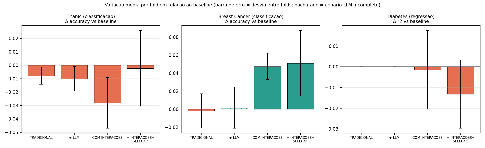
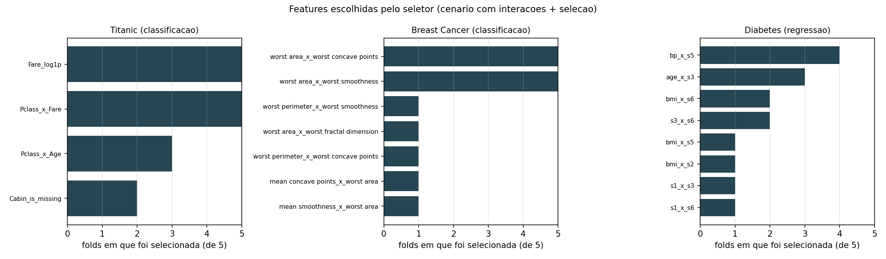
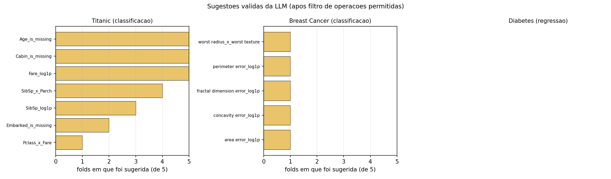

# Resultados dos experimentos AutoFE

Relatorio gerado automaticamente por `python -m src.report` a partir de `results/metrics/` e `results/audits/`. Validacao cruzada com 5 folds compartilhados entre os cenarios. Valores: media ± desvio entre folds.

## Leitura obrigatoria antes dos numeros

- **titanic**: modelo `decision_tree`.
  - LLM: groq / `openai/gpt-oss-120b` — 5/5 folds validos.
- **breast_cancer**: modelo `decision_tree`.
  - ⚠ Cenario `AUTOFE + LLM` **incompleto**: 1/5 folds com resposta da LLM (1 por cota esgotada, 3 bloqueados pelo circuit breaker). Esse resultado nao mede a contribuicao da LLM.
- **diabetes**: modelo `random_forest`.
  - ⚠ Cenario `AUTOFE + LLM` **incompleto**: 0/5 folds com resposta da LLM (0 por cota esgotada, 0 bloqueados pelo circuit breaker). Esse resultado nao mede a contribuicao da LLM.

## 1. Metricas por dataset

### Titanic (classificacao)

Metrica principal: `accuracy`.

| Cenario | accuracy | f1 | f1_positive_class | Δ accuracy |
|---|---|---|---|---|
| BASELINE | 0.7912 ± 0.0365 | 0.7795 ± 0.0378 | 0.7290 ± 0.0453 | +0.0000 |
| AUTOFE TRADICIONAL | 0.7834 ± 0.0335 | 0.7713 ± 0.0350 | 0.7190 ± 0.0427 | -0.0079 |
| AUTOFE + LLM | 0.7811 ± 0.0317 | 0.7700 ± 0.0333 | 0.7193 ± 0.0408 | -0.0101 |
| AUTOFE COM INTERACOES | 0.7632 ± 0.0309 | 0.7523 ± 0.0311 | 0.7003 ± 0.0350 | -0.0280 |
| AUTOFE + INTERACOES + SELECAO | 0.7890 ± 0.0240 | 0.7773 ± 0.0232 | 0.7265 ± 0.0243 | -0.0023 |

**Comparacao pareada com o baseline (mesmos folds):**

| Cenario | Folds melhores | Empates | Folds piores | Δ medio |
|---|---|---|---|---|
| AUTOFE TRADICIONAL | 0/5 | 1 | 4/5 | -0.0079 |
| AUTOFE + LLM | 0/5 | 2 | 3/5 | -0.0101 |
| AUTOFE COM INTERACOES | 0/5 | 0 | 5/5 | -0.0280 |
| AUTOFE + INTERACOES + SELECAO | 2/5 | 1 | 2/5 | -0.0023 |

### Breast Cancer (classificacao)

Metrica principal: `accuracy`.

| Cenario | accuracy | f1 | recall_class_0 | Δ accuracy |
|---|---|---|---|---|
| BASELINE | 0.9104 ± 0.0279 | 0.9028 ± 0.0317 | 0.8588 ± 0.0737 | +0.0000 |
| AUTOFE TRADICIONAL | 0.9086 ± 0.0212 | 0.9021 ± 0.0238 | 0.8819 ± 0.0599 | -0.0018 |
| AUTOFE + LLM ⚠ INCOMPLETO | 0.9121 ± 0.0266 | 0.9058 ± 0.0296 | 0.8913 ± 0.0726 | +0.0017 |
| AUTOFE COM INTERACOES | 0.9578 ± 0.0160 | 0.9549 ± 0.0174 | 0.9482 ± 0.0377 | +0.0474 |
| AUTOFE + INTERACOES + SELECAO | 0.9613 ± 0.0091 | 0.9588 ± 0.0098 | 0.9621 ± 0.0356 | +0.0509 |

**Comparacao pareada com o baseline (mesmos folds):**

| Cenario | Folds melhores | Empates | Folds piores | Δ medio |
|---|---|---|---|---|
| AUTOFE TRADICIONAL | 2/5 | 0 | 3/5 | -0.0018 |
| AUTOFE + LLM | 2/5 | 0 | 3/5 | +0.0017 |
| AUTOFE COM INTERACOES | 5/5 | 0 | 0/5 | +0.0474 |
| AUTOFE + INTERACOES + SELECAO | 5/5 | 0 | 0/5 | +0.0509 |

### Diabetes (regressao)

Metrica principal: `r2`.

| Cenario | r2 | mae | rmse | Δ r2 |
|---|---|---|---|---|
| BASELINE | 0.4294 ± 0.0836 | 46.6925 ± 3.0118 | 57.4918 ± 3.0536 | +0.0000 |
| AUTOFE TRADICIONAL | 0.4294 ± 0.0836 | 46.6925 ± 3.0118 | 57.4918 ± 3.0536 | +0.0000 |
| AUTOFE + LLM ⚠ INCOMPLETO | 0.4294 ± 0.0836 | 46.6925 ± 3.0118 | 57.4918 ± 3.0536 | +0.0000 |
| AUTOFE COM INTERACOES | 0.4279 ± 0.0831 | 46.9578 ± 2.9289 | 57.5587 ± 2.8193 | -0.0014 |
| AUTOFE + INTERACOES + SELECAO | 0.4162 ± 0.0903 | 47.0968 ± 3.1667 | 58.1143 ± 3.0364 | -0.0132 |

**Comparacao pareada com o baseline (mesmos folds):**

| Cenario | Folds melhores | Empates | Folds piores | Δ medio |
|---|---|---|---|---|
| AUTOFE TRADICIONAL | 0/5 | 5 | 0/5 | +0.0000 |
| AUTOFE + LLM | 0/5 | 5 | 0/5 | +0.0000 |
| AUTOFE COM INTERACOES | 3/5 | 0 | 2/5 | -0.0014 |
| AUTOFE + INTERACOES + SELECAO | 1/5 | 0 | 4/5 | -0.0132 |

## 2. Features geradas e selecionadas

### Titanic (classificacao)

| Cenario | Features distintas geradas | Presentes nos 5 folds |
|---|---|---|
| AUTOFE TRADICIONAL | 5 | 5 |
| AUTOFE + LLM | 8 | 5 |
| AUTOFE COM INTERACOES | 15 | 15 |
| AUTOFE + INTERACOES + SELECAO | 15 | 15 |

**Features selecionadas** (cenario com interacoes + selecao):

| Feature | Folds em que foi selecionada | Score medio |
|---|---|---|
| Fare_log1p | 5/5 | 0.1198 |
| Pclass_x_Fare | 5/5 | 0.1181 |
| Pclass_x_Age | 3/5 | 0.0735 |
| Cabin_is_missing | 2/5 | 0.0579 |

### Breast Cancer (classificacao)

| Cenario | Features distintas geradas | Presentes nos 5 folds |
|---|---|---|
| AUTOFE TRADICIONAL | 24 | 20 |
| AUTOFE + LLM | 25 | 20 |
| AUTOFE COM INTERACOES | 39 | 26 |
| AUTOFE + INTERACOES + SELECAO | 39 | 26 |

**Features selecionadas** (cenario com interacoes + selecao):

| Feature | Folds em que foi selecionada | Score medio |
|---|---|---|
| worst area_x_worst concave points | 5/5 | 0.5419 |
| worst area_x_worst smoothness | 5/5 | 0.5426 |
| mean concave points_x_worst area | 1/5 | 0.5171 |
| mean smoothness_x_worst area | 1/5 | 0.5212 |
| worst area_x_worst fractal dimension | 1/5 | 0.5217 |
| worst perimeter_x_worst concave points | 1/5 | 0.5243 |
| worst perimeter_x_worst smoothness | 1/5 | 0.5162 |

### Diabetes (regressao)

| Cenario | Features distintas geradas | Presentes nos 5 folds |
|---|---|---|
| AUTOFE TRADICIONAL | 0 | 0 |
| AUTOFE + LLM | 0 | 0 |
| AUTOFE COM INTERACOES | 20 | 3 |
| AUTOFE + INTERACOES + SELECAO | 20 | 3 |

**Features selecionadas** (cenario com interacoes + selecao):

| Feature | Folds em que foi selecionada | Score medio |
|---|---|---|
| bp_x_s5 | 4/5 | 0.0830 |
| age_x_s3 | 3/5 | 0.0722 |
| s3_x_s6 | 2/5 | 0.0913 |
| bmi_x_s6 | 2/5 | 0.0587 |
| bmi_x_s5 | 1/5 | 0.0556 |
| bmi_x_s2 | 1/5 | 0.0579 |
| s1_x_s3 | 1/5 | 0.0620 |
| s1_x_s6 | 1/5 | 0.0681 |

## 3. Sugestoes da LLM

### Titanic (classificacao)

| Feature sugerida | Operacao | Folds | Ja gerada pelo AutoFE tradicional | Gerada no cenario LLM |
|---|---|---|---|---|
| Age_is_missing | missing_indicator | 5/5 | sim | sim |
| Cabin_is_missing | missing_indicator | 5/5 | sim | sim |
| Fare_log1p | log1p | 5/5 | sim | sim |
| SibSp_x_Parch | interaction_product | 4/5 | nao | sim |
| SibSp_log1p | log1p | 3/5 | sim | sim |
| Embarked_is_missing | missing_indicator | 2/5 | nao | sim |
| Pclass_x_Fare | interaction_product | 1/5 | nao | sim |

### Breast Cancer (classificacao)

⚠ Apenas 1/5 folds receberam resposta da LLM.

| Feature sugerida | Operacao | Folds | Ja gerada pelo AutoFE tradicional | Gerada no cenario LLM |
|---|---|---|---|---|
| area error_log1p | log1p | 1/5 | sim | sim |
| concavity error_log1p | log1p | 1/5 | sim | sim |
| fractal dimension error_log1p | log1p | 1/5 | sim | sim |
| perimeter error_log1p | log1p | 1/5 | sim | sim |
| worst radius_x_worst texture | interaction_product | 1/5 | nao | sim |

### Diabetes (regressao)

Sem sugestoes registradas.

